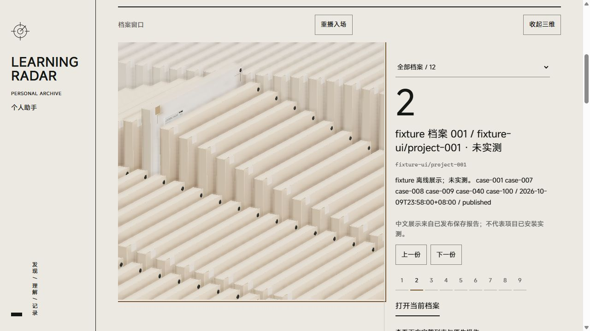
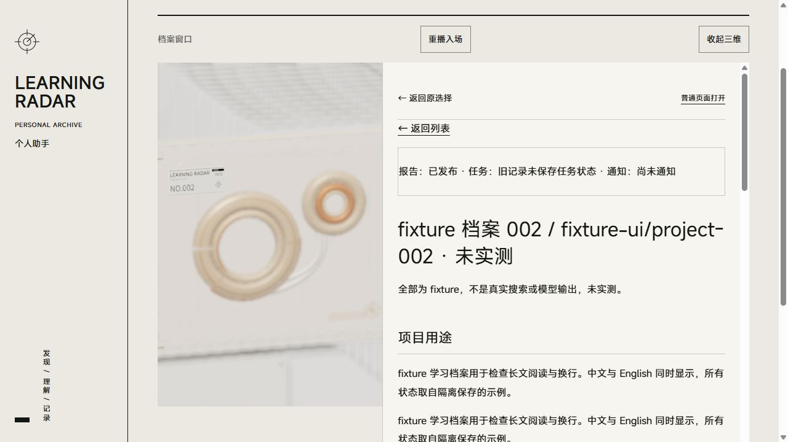

# Learning Radar

[中文](README.md) · [Developer guide](docs/DEVELOPER-GUIDE.md) · [Third-party materials](docs/THIRD-PARTY.md)

A project discovery and reading workbench for one learner. It finds AI/Agent and generative software-engineering projects from public materials, compares them with your explicitly confirmed profile, and saves sourced reports, usage, and project feedback. The default pool favors AI/Agent and does not cover all of GitHub.

Sign in → broad or focused discovery → queued execution and budgets → sourced report or rejected draft → project history → feedback. Python owns native forms, authentication, and CSRF. TypeScript/Vite/Three.js adds same-origin visuals. Sign-in, reading, and feedback work without JavaScript. The interface, reports, and prompts remain Chinese.

> Screenshots and demos use **synthetic fixtures, not actually tested projects**. They do not prove real search/model success, mail receipt, or candidate installation. This is a local review candidate, not published or deployed.




## Prerequisites

- Python **3.11+**: backend uses only the standard library; no third-party pip packages. Windows verification used 3.13.7; other versions were not individually tested.
- Node **22.18+ or 24+**, npm, Git. Tests use native TypeScript stripping. Verification used Node 24.21.0 and npm 11.19.0.
- Source installation requires a frontend build and npm dependencies. The whole project is not dependency-free. The demo launcher uses Windows PowerShell; Linux/systemd/public HTTPS require separate deployment acceptance.

## Offline demo from source

Extract a source archive or enter a source clone and run:

```powershell
# Set an actual interpreter path if python is missing or is a Windows Store alias
$env:LEARNRADAR_PYTHON = (Get-Command python -ErrorAction Stop).Source
& $env:LEARNRADAR_PYTHON --version
Push-Location frontend
npm ci
npm run build
npm test
Pop-Location
& $env:LEARNRADAR_PYTHON scripts/public_smoke.py
powershell -NoProfile -ExecutionPolicy Bypass -File .\scripts\demo.ps1 -OpenBrowser
```

The first `npm ci` downloads packages; complete caches permit `npm ci --offline`. [Proxy instructions](docs/DEVELOPER-GUIDE.md#network-access) use process environments without global changes. Building synchronizes the native inline theme and asset manifest; commercial fonts are unnecessary.

The launcher prints a loopback URL and fixture sign-in guidance. Only isolated `--demo` data uses the fixture account: inspect `FIXTURE_USERNAME` / `FIXTURE_PASSWORD` in `learnradar/auth.py` locally, not as production defaults. Sign in, submit a discovery, read the report, and save feedback. The demo uses `data/demo-2-1` and offline adapters and requires no model/GitHub/SMTP credentials.

```powershell
powershell -NoProfile -ExecutionPolicy Bypass -File .\scripts\demo.ps1 -Action status
powershell -NoProfile -ExecutionPolicy Bypass -File .\scripts\demo.ps1 -Action stop
```

Closing the browser does not stop the worker. Stop manages only recorded PIDs/creation times and retains demo data/budgets. `public_smoke.py` checks sign-in → broad discovery → completed/published → reading → feedback and stops its children.

A prebuilt local review archive includes source and `frontend/dist`: skip npm steps and run smoke/demo directly. It is not a published Release; version/hashes are in `ARTIFACT-MANIFEST.json`.

## Configure real use yourself

Real mode is separate. Missing production accounts deny private pages instead of substituting fixture credentials.

```powershell
Copy-Item .env.example .env
Copy-Item config\profile.example.toml config\profile.toml
# Edit .env, config/settings.toml, profile.toml; review before confirmed_by_user=true
& $env:LEARNRADAR_PYTHON -m learnradar.auth_cli init --data-dir .\data
& $env:LEARNRADAR_PYTHON -m learnradar.task_cli web --data-dir .\data --web-mode loopback --port 0
# Separate terminal: review queued work and notices before authorizing external requests
& $env:LEARNRADAR_PYTHON -m learnradar.task_cli worker --data-dir .\data
```

Passwords use hidden local terminal input. Model roles/endpoints/pricing are in `config/settings.toml`; both default roles use its declared `LEARNRADAR_FALLBACK_API_KEY`, subject to actual `api_key_env`. Providers must support configured model IDs. Coding-assistant credentials are separate from business-model credentials. A read-only GitHub token is optional for higher public-read limits. Mail is optional: copy `email.example.toml` to ignored `email.toml` and configure SMTP; do not enable delivery without notification configuration.

After preparing your own account/profile, `scripts/start.ps1` manages daily services: `-WebOnly` reads only; `-Action status/stop` manages owned processes. Startup does not submit tasks. Review old work/notices first. Separate web/worker terminals stop with Ctrl+C. Keep configuration, SQLite, reports, feedback, materials, and logs ignored and uncommitted.

## Budgets, cost, and limitations

New tasks default to broad: 3 directions, up to 10 candidates each, up to 30 merged. Explicit focused tasks, old tasks, and unchanged weekly runs retain single-direction scope. Defaults allow 3 manual tasks daily and **4 underlying model requests per task**. Analysis and JSON/truncation/field repairs share **2 analysis attempts**. Failures/uncertain consumption are durable; missing pricing means unknown cost. `worker --once` may handle a notice first and does not select a task.

Task completed, report published/rejected, and mail sent/failed/unknown are independent. Passing structure does not guarantee semantics, quality, novelty, or executable projects; candidate code is not automatically run. SMTP acceptance does not prove receipt; unknown delivery must not be blindly resent. One historical saved-evidence replay passed after a second, field-repair attempt. It verified only that repair and did not install the candidate. This public-installation acceptance uses fixtures with zero real business external requests.

Loopback HTTP is explicit development mode. HTTPS cookie policy comes from configuration, not arbitrary forwarding headers. This round does not validate Linux/systemd/Caddy, public TLS/Secure cookies, physical phones, or OS background transitions. Single-user scope excludes registration, recovery, OAuth, chat, and multi-user teams.

## Tests and architecture

```powershell
& $env:LEARNRADAR_PYTHON scripts/offline_tests.py
& $env:LEARNRADAR_PYTHON scripts/public_smoke.py
```

| Path | Purpose |
| --- | --- |
| `learnradar/net.py`, `collector.py`, `sources_github.py` | Public reads, private-network guards, evidence |
| `tasks.py`, `worker.py`, `task_cli.py` | Queue, kernel lock, budgets, shared execution |
| `models.py`, `analysis.py`, `validate.py`, `report.py` | Models, bounded repair, gates, reports |
| `web.py`, `auth*.py`, `archive*.py` | Native pages, authentication, report/project identity |
| `frontend/` | Same-origin visuals, manifest, failure fallback |
| `config/`, `prompts/`, `tests/` | Empty credentials/synthetic templates, Chinese prompts, offline regressions |
| `data/`, `logs/` | Ignored private runtime artifacts |

## Licensing and acknowledgments

Original code has an [MIT proposal](LICENSE-MIT.DRAFT.txt), **pending approval and not effective**; root `LICENSE` records the state. Third parties retain [their own terms](docs/THIRD-PARTY.md). Visual code adapts [LBEILC/RhineLabUI](https://github.com/LBEILC/RhineLabUI) with MIT attribution. Original programmatic music retains provenance. Unmodified MiSans embeds Xiaomi copyright/license; it is not MIT or a standalone font product.

The local public candidate restores the accepted original model, contour, materials, lighting and motion. Generic visual replacements are withdrawn. The [visual baseline and distribution notes](docs/PUBLIC-VISUALS.md) distinguish the upstream author's MIT grant from underlying marks/design rights. Commercial Novecento and old font-containing bundles are absent from source, reachable history, and archives. MiSans/system fallback works; the private edition remains unchanged. Development is AI-assisted without invented manual-authorship percentages or third-party rights. Future commits/docs are English; Chinese UI/reports/prompts/test data remain Chinese. The [video outline](docs/VIDEO-OUTLINE.md) includes shots and Chinese narration. Actual repository/video URLs follow publication.
