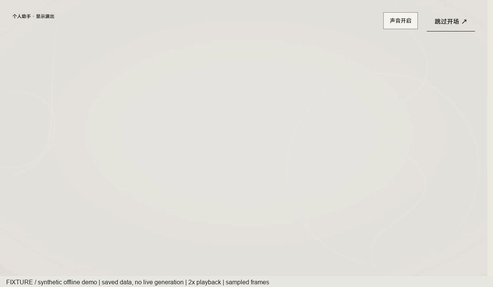
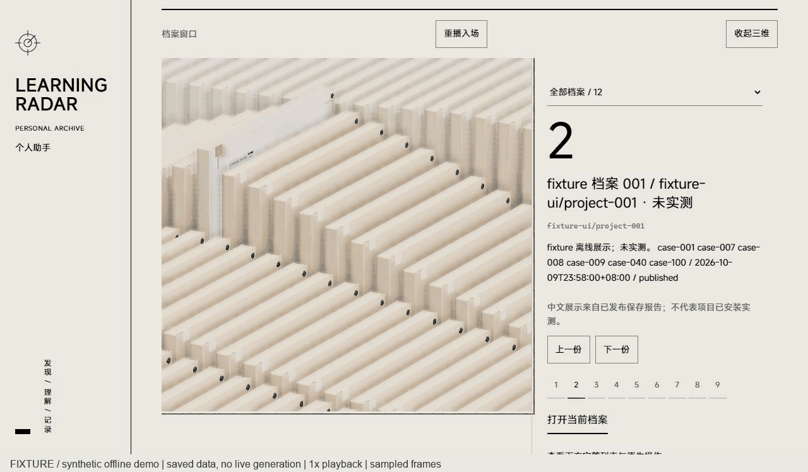

# Learning Radar

[English](README.en.md) · [开发指南](docs/DEVELOPER-GUIDE.md) · [许可与素材](docs/THIRD-PARTY.md)

给单用户学习者的项目发现与阅读工作台。从公开材料寻找值得了解的 AI/Agent 与生成式软件工程项目，结合你确认的学习档案，保存带来源的对照报告、用量和项目反馈。默认搜索池偏 AI/Agent，不代表覆盖整个 GitHub。

登录 → 广泛发现或指定方向 → 队列执行与预算记录 → 有来源的报告或拒绝草稿 → 项目中心 → 反馈。Python 保留原生表单、认证和 CSRF；TypeScript/Vite/Three.js 提供同源视觉增强。无 JavaScript 仍可登录、阅读和反馈。

> 截图和演示均为 **fixture 合成数据，未实测**，不代表真实搜索、真实模型、邮件送达或候选项目安装成功。源码仓库：[Amamiyaren-1/learning-radar-app](https://github.com/Amamiyaren-1/learning-radar-app)。本项目未部署为公网服务。




实际页面演示使用恢复后的原版视觉和隔离合成数据。开场保留原录制，2 倍速；第二张由使用者提供的视频转为 GIF，整段原速、10 帧/秒。两张均无声，未生成新报告。剪辑与帧审查说明见[图像索引](docs/SCREENSHOTS.md)。静态入口：[首页](docs/images/fixture-home.jpg) · [报告阅读](docs/images/fixture-report.jpg)。另有[历史分析脱敏节选](docs/examples/historical-project.zh.md)，与 GIF 的合成报告分开标注。

## 前置条件

- Python **3.11+**：后端仅标准库，无第三方 pip 依赖。本轮 Windows 验证为 3.13.7，其他版本未逐一实测。
- Node **22.18+ 或 24+**、npm、Git。测试使用原生 TypeScript 去类型支持；本轮为 Node 24.21.0、npm 11.19.0。
- 源码安装必须构建前端，前端有 npm 依赖，项目整体不是零依赖。Windows 演示用 PowerShell；Linux/systemd/公网 HTTPS 需另行部署验收。

## 从源码运行离线演示

解压源码包或进入源码克隆目录，执行：

```powershell
# python 不在 PATH 或指向 Windows 商店别名时，改为实际解释器绝对路径
$env:LEARNRADAR_PYTHON = (Get-Command python -ErrorAction Stop).Source
& $env:LEARNRADAR_PYTHON --version
Push-Location frontend
npm ci
npm run build
npm test
Pop-Location
& $env:LEARNRADAR_PYTHON scripts/public_smoke.py
powershell -NoProfile -ExecutionPolicy Bypass -File .\scripts\demo.ps1 -OpenBrowser
```

首次 `npm ci` 下载依赖，完整缓存可用 `npm ci --offline`。[代理说明](docs/DEVELOPER-GUIDE.md#network-access)只使用进程环境，不改全局配置。构建同步原生内联主题和资源清单，不需要商业字体。

启动器打印回环地址和 fixture 登录说明。演示账号仅由 `--demo` 的隔离库提供，本机查看 `learnradar/auth.py` 的 `FIXTURE_USERNAME` / `FIXTURE_PASSWORD`，不把它当正式默认密码。登录后提交一次发现，阅读报告并保存反馈。演示使用 `data/demo-2-1` 和离线适配器，不需要模型、GitHub 或 SMTP 凭据。

```powershell
powershell -NoProfile -ExecutionPolicy Bypass -File .\scripts\demo.ps1 -Action status
powershell -NoProfile -ExecutionPolicy Bypass -File .\scripts\demo.ps1 -Action stop
```

关浏览器不停止 worker。停止命令仅管理记录的 PID 与创建时间，保留演示数据和额度。`public_smoke.py` 自动检查登录 → broad 发现 → completed/published → 阅读 → 反馈，并停止自己的子进程。

预构建评审包包含源码及 `frontend/dist`：可跳过 npm 命令，直接运行 smoke 和演示启动器。它尚未作为正式 Release 发布，版本和文件哈希见包内 `ARTIFACT-MANIFEST.json`。

## 自定义用户画像

复制 `config/profile.example.toml` 为本地 `config/profile.toml`（已被 Git 忽略）。修改 `[identity]` 中的背景、已有技能、设备、每天可用时间和语言偏好，`[goals]` 中的目标，以及 `[resources]` 中可用的服务、云资源、GPU 和系统条件；不确定的内容保留“未知/未提供”。核对完整内容后，再将顶层 `confirmed_by_user` 设为 `true`，并更新日期。示例不代表任何固定个人背景或偏好。

画像用于项目初筛和后续分析。真实模式下，画像及相关项目反馈可能组成分析提示词，发送至使用者在 `config/settings.toml` 中配置的模型提供商；启用真实请求前请审阅这些内容与提供商的数据政策。真实画像、反馈、完整运行提示词、材料和报告应留在本地忽略目录，不应提交或打包公开。

画像只填写资源条件，例如“有可用的模型服务”或“没有 GPU”，不要填写真实 API Key、Token、SMTP 密码或其他认证值。密钥填写在忽略的 `.env` 或环境变量中，变量名以模型的 `api_key_env` 和邮件的 `password_env` 为准。不要把画像确认等同于外发授权。

## 自己配置真实模式

真实模式与 fixture 分开。没有正式账号时拒绝私人页面，不使用 fixture 常量替代登录。

```powershell
Copy-Item .env.example .env
Copy-Item config\profile.example.toml config\profile.toml
# 本机编辑 .env、config/settings.toml、profile.toml；审阅后才设 confirmed_by_user=true
& $env:LEARNRADAR_PYTHON -m learnradar.auth_cli init --data-dir .\data
& $env:LEARNRADAR_PYTHON -m learnradar.task_cli web --data-dir .\data --web-mode loopback --port 0
# 独立终端：先检查队列和待通知，确认允许外发再启动
& $env:LEARNRADAR_PYTHON -m learnradar.task_cli worker --data-dir .\data
```

密码仅在本机终端隐藏输入。模型角色、端点和价格来自 `config/settings.toml`；默认 screening/analysis 都使用该文件声明的 `LEARNRADAR_FALLBACK_API_KEY`，以实际 `api_key_env` 为准。提供方须支持实际 model ID；编码助手账号不等于业务模型凭据。GitHub 只读 Token 可选，用于提高公开读取限额。邮件通知可选：自行复制 `email.example.toml` 到忽略的 `email.toml` 并配置 SMTP；不配置通知时不要启用发送。

本人账号/档案准备后可用 `scripts/start.ps1` 管理日常服务，`-WebOnly` 只读，`-Action status/stop` 检查/停止自身服务。启动不提交任务，旧任务/通知先人工审阅。独立 web/worker 终端用 Ctrl+C 停止。配置、SQLite、报告、反馈、材料和日志留在忽略目录，不提交。

## 预算、费用和限制

默认新任务 broad：3 方向、每方向最多 10、合并最多 30。显式 focused、旧任务和未明确切换的 weekly 保持原单方向。默认每日 3 个手动任务、每任务最多 **4 次底层模型请求**；分析及 JSON/截断/字段修复共用 **2 次分析机会**。失败和不确定消费持久记账，缺价格显示“费用未知”。`worker --once` 可能先处理通知，并非指定任务开关。

任务 completed、报告 published/rejected、邮件 sent/failed/unknown 是独立状态。结构通过不保证语义、推荐质量、创新性或项目可运行；程序不会自动执行候选代码。SMTP 接受不等于收件人收到，unknown 不能盲目重发。保存证据重放只验证选定材料的处理，不证明候选安装成功。公开安装验收使用 fixture，不外发真实业务请求。

回环 HTTP 仅为显式开发模式；HTTPS Cookie 策略来自配置，不信任任意转发头。新版 Linux/systemd/Caddy、公网 TLS/Secure Cookie、实体手机及系统后台切换尚未本轮验收。保持单用户，不提供注册、找回、OAuth、聊天或多用户团队。

## 测试与结构

```powershell
& $env:LEARNRADAR_PYTHON scripts/offline_tests.py
& $env:LEARNRADAR_PYTHON scripts/public_smoke.py
```

| 路径 | 作用 |
| --- | --- |
| `learnradar/net.py`, `collector.py`, `sources_github.py` | 公网读取、内网拦截、取证 |
| `tasks.py`, `worker.py`, `task_cli.py` | 队列、内核锁、预算、统一执行 |
| `models.py`, `analysis.py`, `validate.py`, `report.py` | 模型、有限修复、质量门槛、报告 |
| `web.py`, `auth*.py`, `archive*.py` | 原生页面、认证、报告与项目身份 |
| `frontend/` | 同源视觉增强、资源清单、失败回退 |
| `config/`, `prompts/`, `tests/` | 空凭据/合成档案模板、中文提示词、离线回归 |
| `data/`, `logs/` | 忽略的私人运行产物 |

## 许可与致谢

原创 Learning Radar 代码采用 [MIT 许可证](LICENSE)。第三方按[逐项清单](docs/THIRD-PARTY.md)及原许可证处理。视觉代码改编自 [LBEILC/RhineLabUI](https://github.com/LBEILC/RhineLabUI)，保留 MIT 版权；原创程序配乐保留来源。MiSans 未修改，随应用保留 Xiaomi 版权和许可，不标 MIT，不单独作为字体产品分发。

本公开仓库保留已认可的原版模型、轮廓、材质、灯光与动效，视觉基线冻结。[视觉基线与分发范围](docs/PUBLIC-VISUALS.md)区分上游作者 MIT 授权与原作标识/视觉权利。商业 Novecento 和旧含字体构建不进入源码、可达历史或包；MiSans/系统字体回退可用，私有版视觉不改。开发有 AI 辅助，不虚构手写比例或第三方权利。未来提交和开发文档用英文，中文界面/报告/提示词/测试数据保留。[视频脚本](docs/VIDEO-OUTLINE.md)提供镜头及中文旁白，源码地址见上方；视频尚未上传。
